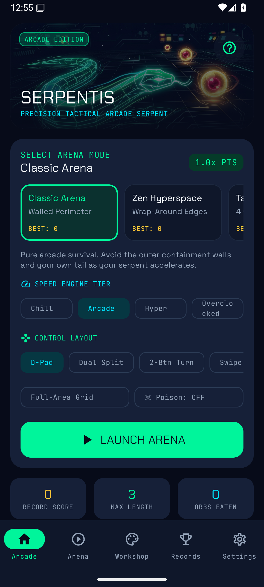
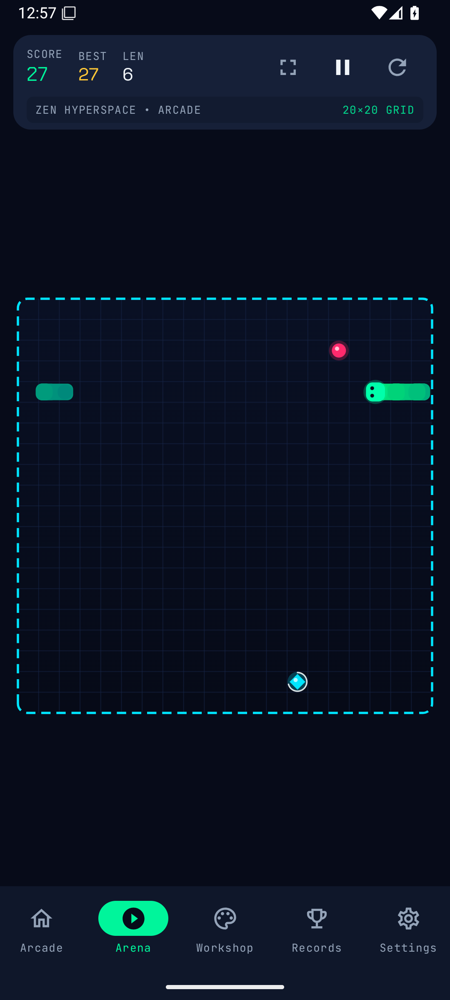

# Serpentis — Precision Tactical Arcade Snake for Android


-00C853?style=for-the-badge&logo=android&logoColor=white)


**Serpentis** is a fast, lightweight, customizable, offline-first tactical arcade Snake game built natively for Android with **Kotlin**, **Jetpack Compose (Material 3)**, and **Room SQLite**. Engineered for zero-latency responsiveness, it combines a deterministic tick engine, 60 FPS sub-tick interpolation, a 2-step turn queue with L-swipe cornering protection, procedural 16-bit PCM synthesized sound effects, and adaptive layouts for phones, foldables, tablets, and ChromeOS.

---

## Screenshots

<p align="center">
  <table>
    <tr>
      <td align="center">
        
        <br />
        <sub><b>Arcade Home & Launcher</b> — Modes, Speed Tiers, Controls & Poison Toggle</sub>
      </td>
      <td align="center">
        
        <br />
        <sub><b>Live Arena Gameplay</b> — Fixed-Height HUD, Wrap-Around Grid & Power-Ups</sub>
      </td>
    </tr>
  </table>
</p>

---

## Key Features

### 1. Five Distinct Game Modes
| Mode | Multiplier | Mechanics |
| :--- | :---: | :--- |
| **Classic Arena** | `1.0x` | Electrified containment walls. One perimeter wall impact ends the run. |
| **Zen Flow** | `0.85x` | Seamless wrap-around perimeter borders for relaxed, endless high-length runs. |
| **Labyrinth** | `1.35x` | Tactical internal fortifications with 4 selectable sector maps (*Crosshair Pillars*, *Twin Gates*, *Central Vault*, *Corner Bunkers*). |
| **Portal Flux** | `1.40x` | Linked dimensional warp gates across the board that teleport the serpent and award bonus Flux points. |
| **Time Blitz (120s)** | `1.50x` | High-tempo 2-minute score attack. Cyber Apples add `+2s`, Golden Cores add `+5s`, and perimeter impacts trim tail segments instead of ending the run. |

---

### 2. Speed Engine Tiers & Dynamic Poison Defaults
| Tier | Base Tick | Min Tick | Score Multiplier | Default Poison Skulls (`☠`) |
| :--- | :---: | :---: | :---: | :---: |
| **Chill** | `175 ms` | `110 ms` | `0.85x` | Off *(togglable)* |
| **Arcade** | `130 ms` | `72 ms` | `1.00x` | Off *(togglable)* |
| **Hyper** | `96 ms` | `54 ms` | `1.35x` | **On by default** *(togglable)* |
| **Overclocked** | `74 ms` | `42 ms` | `1.75x` | **On by default** *(togglable)* |

---

### 3. Power-Ups, Collectibles & Togglable Poison Hazards
- **Cyber Apple (`●`)**: Core energy orb (`+10 pts`, `+1 length`, extends combo chain).
- **Golden Core (`★`)**: High-value bonus orb (`+50 pts`, `+2 length`, `+5s` in Time Blitz) that spawns every 5 Cyber Apples.
- **Flux Magnet (`🧲`)**: Temporary magnetic field (`55 ticks`) that pulls all non-hazard food and power-up items within a **4-tile Chebyshev radius** one tile closer toward the serpent's head on each tick. **Never attracts Poison Skulls.**
- **Chrono Shard (`◆`)**: Slows down engine tick speed by `45%` for `45 ticks` for tight tactical maneuvering.
- **Phase Ghost (`◈`)**: Spectral phasing (`48 ticks`) allowing the serpent to pass safely through its own tail, Labyrinth obstacles, and Poison Skulls.
- **2x Overdrive (`⚡`)**: Doubles all food and portal score multipliers for `55 ticks`.
- **Nano Shrink (`✂`)**: Safely trims `3` tail segments (`+35 pts`) when the serpent is 10+ segments long.
- **Poison Skull (`☠`)**: Togglable lethal hazard (`45 ticks` lifespan):
  - At most **one** Poison Skull appears on the grid at any time.
  - **Head-Safe Spawning**: Never spawns within a 5-tile Manhattan / 4-tile Chebyshev radius of the serpent's head or in the 5 tiles directly ahead of its current heading.
  - **Timed Relocation**: Automatically disappears when its countdown expires and respawns after a brief cooldown at a **different tile**.
  - **Instant Game Over on Contact**: Direct contact immediately ends the run (`DeathReason.POISON_CONSUMED`) unless `PHASE_GHOST` is active.

---

### 4. Precision Mobile & Desktop Controls
- **2-Step Buffered Turn Queue**: Rapid cornering inputs (e.g., `UP` then `LEFT` within a single tick) are queued sequentially across consecutive ticks, preventing accidental 180° self-collisions.
- **L-Swipe Protection & Full-Screen Outer-Margin Swipes**:
  - Swipes are accepted anywhere inside **or outside** the play grid (excluding the top HUD header, bottom navigation bar, and control buttons).
  - Continuous multi-directional swipes are capped at **2 perpendicular turns per gesture** with cross-axis drift filtering so an L-swipe never queues an unintended 3rd self-biting turn.
- **3 Ergonomic On-Screen Control Schemes**:
  - **Tactical D-Pad**: Classic 4-way directional cross + Full-Screen Swipe.
  - **Dual Turn Paddles**: Left (`↺ Counter-Clockwise`) and Right (`↻ Clockwise`) relative thumb paddles.
  - **Pure Swipe Arena**: Maximizes vertical space for the board while accepting gestures across the entire play region.
- **Hardware Keyboard Support**: Full support for `WASD` / `Arrow Keys` and `Space` / `P` to pause/resume on tablets, ChromeOS, and Android emulators.

---

### 5. Full-Area Adaptive Play Grid, App Themes & Customization Workshop
- **App Interface Themes**:
  - **Dark Graphite** *(Default)*: Matte neutral charcoal-gray surfaces designed for crisp, distraction-free focus.
  - **Midnight Cyber**: Classic deep obsidian-navy theme with neon blue-green highlights.
  - **Soft Light**: Warm off-white paper surfaces (`#F2EFE9` / `#F7F5F0`, zero harsh pure-white glare) engineered for daytime comfort.
  - **Match Device & Material You**: Automatically follow the device's system light/dark mode and optionally sync with Android 12+ Material You dynamic wallpaper colors.
- **6 Customizable Accent Palettes**: *Emerald Cyan* (default), *Cobalt Teal*, *Amber Gold*, *Crimson Coral*, *Violet Orchid*, and *Monochrome Slate* — each independently calibrated for contrast on both Dark and Soft Light themes.
- **6 Play Arena Themes**: *Graphite Matte* (dark charcoal board auto-paired with a warm off-white snake), *Soft Paper* (warm off-white board auto-paired with a black/slate-gray snake), *Obsidian Grid*, *Retro 1998 LCD (Nokia 3310 pixel matrix)*, *Synthwave Dusk*, and *Carbon Tactical*.
- **8 Serpent Skins**: *Soft Ivory*, *Charcoal Ink*, *Cyber Emerald*, *Solar Flare*, *Plasma Violet*, *Glacier Frost*, *Matrix 3310*, and *Imperial Gold*.
- **Full-Area Play Grid Mode**: Dynamically computes rectangular grid dimensions (`cols × rows`) from the measured play area so square cells fill the entire space between the fixed-height HUD header and bottom controls without ever shifting when status buffs appear.
- **4 Base Grid Densities**: *Compact (15×15)*, *Standard (20×20)*, *Wide (24×24)*, and *Ultra (28×28)*.

---

### 6. Procedural Audio, Haptics & Offline Persistence
- **Zero-Asset 16-Bit PCM Audio Synthesizer**: Real-time procedural waveform generator (`ArcadeFeedbackManager`) producing crisp retro arcade chimes, combo arpeggios, portal warps, and game-over sweeps via `AudioTrack`.
- **Tactile Haptics**: Distinct vibration patterns for directional turns, apple collection, power-ups, and collisions.
- **Instant Auto-Save & Resume**: Pausing or backgrounding the app automatically serializes the full board state (snake segments, active buffs, portals, obstacles, food, and Poison Skull timers) to Room SQLite so runs can be resumed anytime from the Home screen.
- **Hall of Fame & 10 Career Achievements**: Persistent leaderboards filterable by arena mode, lifetime telemetry, and unlockable achievement badges.

---

## Architecture & Project Structure

Serpentis follows a clean, modular **MVVM (Model-View-ViewModel)** architecture with a pure Kotlin deterministic game engine:

```text
Serpentis/
├── app/
│   ├── src/
│   │   ├── main/
│   │   │   ├── java/com/example/
│   │   │   │   ├── data/
│   │   │   │   │   ├── AppDatabase.kt           # Room SQLite database & entities
│   │   │   │   │   └── GameRepository.kt        # Run history, auto-save & settings persistence
│   │   │   │   ├── engine/
│   │   │   │   │   ├── ArcadeFeedbackManager.kt # 16-bit PCM audio synthesizer & haptics
│   │   │   │   │   └── SnakeGameEngine.kt       # Deterministic tick engine, Magnet & Poison logic
│   │   │   │   ├── model/
│   │   │   │   │   └── GameModels.kt            # Immutable models, modes, buffs, skins & catalog
│   │   │   │   ├── ui/
│   │   │   │   │   ├── components/
│   │   │   │   │   │   ├── GameControls.kt      # D-Pad, Split Turn Paddles & swipe hint bar
│   │   │   │   │   │   └── SnakeBoardCanvas.kt  # 60 FPS hardware-accelerated Compose Canvas
│   │   │   │   │   ├── screens/
│   │   │   │   │   │   ├── HomeScreen.kt        # Mode/difficulty launcher, Resume & Manual
│   │   │   │   │   │   ├── ArenaScreen.kt       # Fixed-height HUD, gesture region & overlays
│   │   │   │   │   │   ├── WorkshopScreen.kt    # Live skin, arena theme & grid studio
│   │   │   │   │   │   ├── RecordsScreen.kt     # Leaderboards, career telemetry & achievements
│   │   │   │   │   │   └── SettingsScreen.kt    # Controls, sensitivity, audio, haptics & reset
│   │   │   │   │   ├── theme/
│   │   │   │   │   │   ├── Color.kt             # Graphite, Midnight Cyber & Soft Off-White palettes
│   │   │   │   │   │   ├── Theme.kt             # Dynamic M3 Dark/Light + Material You color schemes
│   │   │   │   │   │   └── Type.kt              # Orbitron, Space Grotesk & JetBrains Mono fonts
│   │   │   │   │   └── GameViewModel.kt         # Coroutine game loop, state flows & coordination
│   │   │   │   └── MainActivity.kt              # Edge-to-edge host, keyboard handler & adaptive nav
│   │   │   ├── res/                             # Adaptive launcher icons, fonts, strings & XML rules
│   │   │   └── AndroidManifest.xml
│   │   └── test/java/com/example/
│   │       ├── ExampleUnitTest.kt               # Engine, Magnet, Poison & Theme unit tests
│   │       └── ExampleRobolectricTest.kt        # Compose UI navigation, theme & toggle tests
│   ├── build.gradle.kts
│   └── proguard-rules.pro
├── dist/
│   └── readme_dist.md                           # Pre-built APK download & local output directory
├── screenshots/
│   ├── screenshot_1.png                         # Arcade Home & Launcher preview
│   └── screenshot_2.png                         # Live Arena Gameplay preview
├── .github/workflows/
│   ├── android-ci.yml                           # GitHub Actions CI & test verification
│   └── release.yml                              # Automated versioned APK release (e.g. v0.1.1)
├── CHANGELOG.md
├── CONTRIBUTING.md
├── LICENSE
└── SECURITY.md
```

---

## Building, Testing & Installing

### Prerequisites
- **JDK 21+** (required by Android SDK 36 & Robolectric 4.16.1) or Android Studio Ladybug / Meerkat+
- **Android SDK** with API Level 36 (`minSdk = 24`, `targetSdk = 36`)
- **Gradle 9.3.1**

### Download Pre-Built APK & Automated Releases (GitHub)
- **GitHub Releases (`v0.1.1`)**: Open the repository **Releases** page and download `serpentis-v0.1.1.apk`.
- **Publishing a Versioned Release**: Go to **Actions → Release Serpentis APK → Run workflow** (or push a version tag like `git tag v0.1.1 && git push origin v0.1.1`). The workflow automatically reads `versionName` from `app/build.gradle.kts`, runs all unit & Robolectric tests, builds `serpentis-v0.1.1.apk`, extracts release notes from `CHANGELOG.md`, and publishes the versioned **`v0.1.1`** release in GitHub Releases.
- **CI Build Artifacts**: Every push and pull request runs **Actions → Serpentis Android CI** and uploads the latest verified APK artifact.

### 1. Run Unit & Robolectric UI Tests
```bash
gradle :app:testDebugUnitTest
```

### 2. Build the Installable Debug APK Locally
If `debug.keystore` does not exist in the project root (for fresh GitHub clones), generate a local debug keystore once:
```bash
keytool -genkeypair -v -keystore debug.keystore -storepass android -alias androiddebugkey -keypass android -keyalg RSA -keysize 2048 -validity 10000 -dname "CN=Android Debug,O=Android,C=US"
```
Then build the APK:
```bash
gradle :app:assembleDebug
```
The compiled APK is generated at:
- `app/build/outputs/apk/debug/app-debug.apk`

### 3. Install on a Connected Android Device
```bash
adb install -r serpentis.apk
```

---

## Privacy & Security

- **100% Offline & Self-Contained**: Serpentis requires **no internet permission**, makes zero network calls, and includes no analytics trackers or advertisements.
- **Least-Privilege Permissions**: Requests only `android.permission.VIBRATE` (install-time normal permission) for optional tactile feedback.
- **Data Protection**: Configured with `android:allowBackup="false"` and strict ProGuard/R8 rules for Room entities and serialized game models.

---

## License

Released under the [MIT License](LICENSE).
